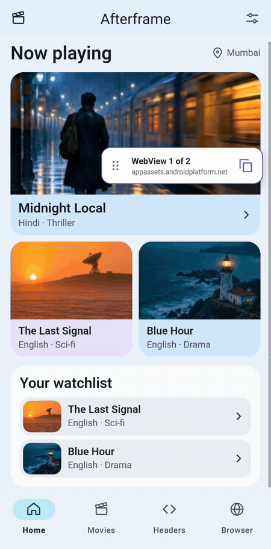
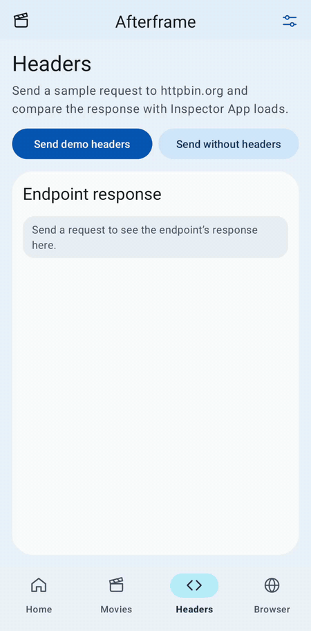
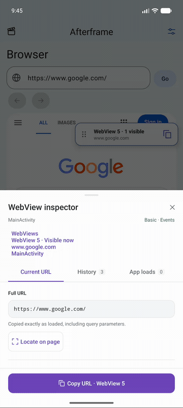

<div align="center">

# WebView Inspector

**See current URLs, navigation history, and app-supplied headers in your Android WebViews.**

[Maven Central 0.4.0](https://repo.maven.apache.org/maven2/io/github/chinmaydash007/webview-inspector/0.4.0/)
· [Production no-op](https://repo.maven.apache.org/maven2/io/github/chinmaydash007/webview-inspector-no-op/0.4.0/)
· [Apache 2.0](LICENSE)

</div>

## See it in Afterframe

[Afterframe](sample/) is an Android sample with four WebView scenarios. **Basic** discovers visible WebViews after a single app-wide install. **Advanced** adds a record of the URL and headers passed to the explicit load helper.

| Home · Embedded WebViews | Movies · Offline navigation |
| :---: | :---: |
|  |  |
| Pick between **Now playing** and **Your watchlist**, then use **Locate on page** to highlight the selected WebView. | Follow an offline movie page to a showtime. Inspect the URL and its query parameters, then see both pages in **History**. |
| [Watch Home MP4](sample/demo-media/home.mp4) | [Watch Movies MP4](sample/demo-media/movies.mp4) |

| Headers · Explicit app loads | Browser · Live navigation |
| :---: | :---: |
|  |  |
| Match a demo header in **App loads** to the live httpbin receipt, then send a request without extra headers. **App loads** shows what the app supplied. The receipt shows what httpbin received. | Open `google.com` and visit **About**. Use **Back** and **Forward**, then review the navigation in **History**. |
| [Watch Headers MP4](sample/demo-media/headers.mp4) | [Watch Browser MP4](sample/demo-media/browser.mp4) |

To try it, open the repo in Android Studio with JDK 17 and Android SDK 36,
then run the `sample` **debug** variant. Headers and Browser need internet access.

## Install

WebView Inspector supports Android API 24 and later. Use `google()` and
`mavenCentral()`, and include one artifact per build variant.

```kotlin
dependencies {
    debugImplementation("io.github.chinmaydash007:webview-inspector:0.4.0")
    releaseImplementation("io.github.chinmaydash007:webview-inspector-no-op:0.4.0")
}
```

Import `com.webviewinspector.WebViewInspector` and install it once in your
`Application.onCreate()`.

```kotlin
override fun onCreate() {
    super.onCreate()
    WebViewInspector.install(this)
}
```

Open a screen with a WebView and tap the floating Inspector. Use the optional load
helper to see app-supplied inputs under **App loads**.

```kotlin
WebViewInspector.loadUrl(webView, url, headers)
```

[Full usage guide](USAGE.md) · [Architecture](webview-inspector/docs/ARCHITECTURE.md)
· [Contributing](CONTRIBUTING.md) · [Validation](VALIDATION.md) · [Releasing](docs/RELEASING.md)
