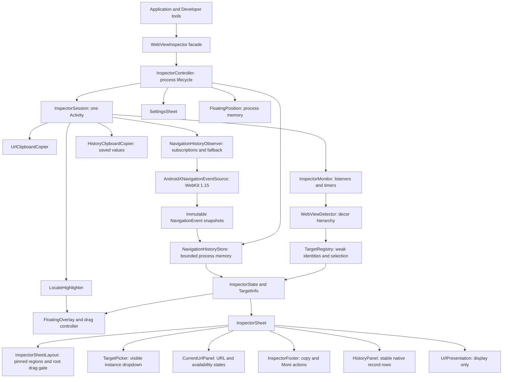
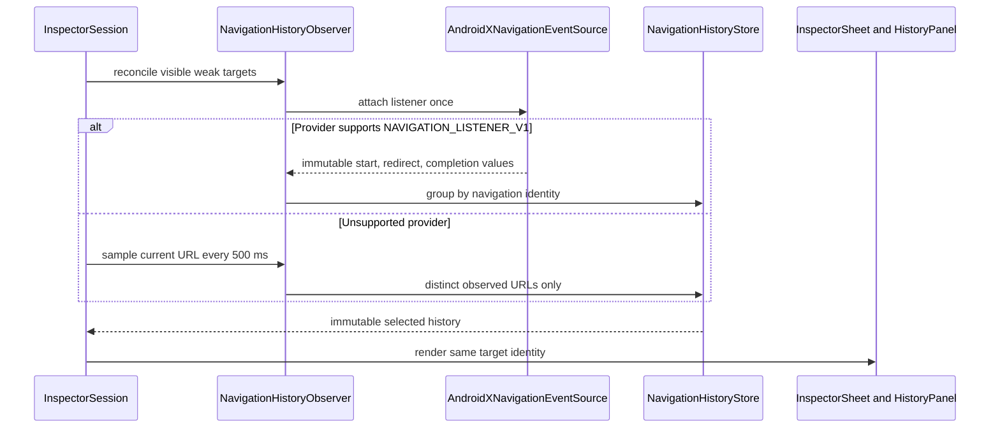
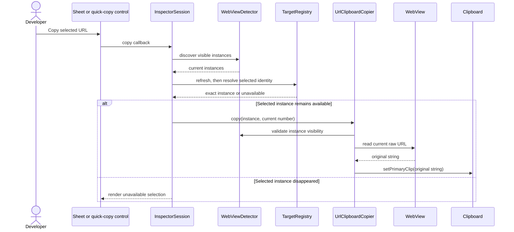
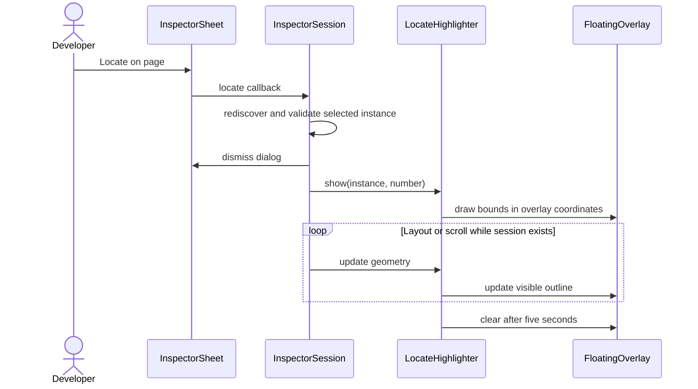

# WebView Inspector architecture

Read this after the [module README](../README.md). This describes the native View/controller implementation, including the ownership rules that make it safe to attach to existing Activities.

## High-level architecture

Arrows describe ownership or data flow. The session constructs collaborators and supplies callbacks; UI callbacks return to the session rather than importing `core`. `ui.common` supplies native View styling and Material dialog construction to both sheets and the floating control.

Only the facade is a supported public entry point. All implementation types live below `io.github.chinmaydash007.webviewinspector.internal` and are Kotlin `internal`. There are no ViewModels, repositories, injected JavaScript, or per-screen hooks.

The publisher identity is configured by `INSPECTOR_PACKAGE` in the root Gradle properties.
Both artifacts expose the same facade package; only the no-op Android resource namespace
adds `.noop`. API checks, emulator runners and CI harness paths read that canonical value.
Moving to 0.2.0 changes package identity only, without retaining a legacy facade alias.
Publication guards validate nested class/source/documentation contents and dependency
inventories before any signed bundle is uploaded.

A host installs the facade once from Application.onCreate. Settings may use `showSettings(Activity)` or an app-owned toggle calling `isEnabled()` / `setEnabled()`. The host does not own discovery or restore a separate persisted value over process state.

## Package responsibilities

All package names below are relative to `io.github.chinmaydash007.webviewinspector.internal`.

| Package | Main types | Responsibility and boundary |
|---|---|---|
| `core` | `InspectorController`, `InspectorSession`, `InspectorMonitor`, `NavigationHistoryObserver`, `AndroidXNavigationEventSource` | Own lifecycle, subscriptions, scheduling and coordination. Only the adapter imports experimental WebKit APIs. |
| `detection` | `WebViewDetector` | Traverse the source Activity decor and validate visibility. No listeners, URL formatting, UI, or WebView mutations. |
| `state` | `TargetRegistry`, `InspectorActivityState`, `NavigationHistoryStore`, history values, render/position values | Weak instance identity, Activity-scoped selection/tab preferences, immutable records and process-wide budgets. No live UI ownership. |
| `actions` | `UrlClipboardCopier`, `HistoryClipboardCopier`, `LocateHighlighter` | Live copying/highlighting validates the selected view; historical copying reads explicit saved values. |
| `ui.floating` | `FloatingOverlay`, `FloatingDragController` | Render the control/outline and handle movement, snapping, insets, keyboard, and accessibility movement. |
| `ui.sheet` | `InspectorSheet`, `TargetPicker`, `CurrentUrlPanel`, `InspectorFooter`, `HistoryPanel`, `SettingsSheet` | Coordinate the Focused native UI, render immutable state and own transient child windows. Send actions through callbacks. |
| `ui.common` | `BottomSheetFactory`, `InspectorSheetLayout`, `SheetDragGuard`, `SheetScrollView`, View extensions | Construct library-themed dialog chrome, coordinate content/sheet gestures, and share View styling. No selection, polling, or URL access. |
| `util` | `UrlPresentation`, `HistoryPresentation` | Display-only URL/query formatting and localized history labels/times. Raw URLs always come from saved values or a fresh live read. |

## Installation, discovery, and rendering

1. `WebViewInspector.install(application)` serializes installation on the main thread. Repeated installation preserves the current controller and toggle state.
2. `InspectorController` registers application lifecycle callbacks. A resumed Activity gets a weak focus watch and one `InspectorSession`. The controller keeps weak target registries per Activity and one normalized floating position for the process.
3. The session attaches its interactive overlay to `android.R.id.content`. Detection traverses the Activity **decor**, excluding that overlay. Attaching to content preserves compatibility with SDKs that route input directly to content; each discovery also repairs attachment after `setContentView` replaces it.
4. `InspectorMonitor` performs initial discovery after posted attachment work, debounces layout/scroll discovery by **100 ms**, rescans every **1 second**, and requests URL/render sampling every **500 ms**. `WebViewDetector` includes visible native WebViews of every size and subclass, including Compose AndroidView and RecyclerView/Epoxy children.
5. `TargetRegistry` compares instances using `===`, retains weak references, and preserves selection through reordering. The first discovered target is selected automatically. Once that selected instance disappears, another target must be explicitly selected, even if the list later becomes non-empty again.
6. The session reads current URLs on the main thread into an immutable `InspectorState`. Both the control and sheet render the same selected identity. Numbers describe current hierarchy order; they are not permanent IDs. URL-only changes update existing sheet rows without removing their focus.

## Central navigation history

`InspectorController` owns one `NavigationHistoryStore` and weak Activity-keyed `InspectorActivityState` values. Each Activity receives a unique scope; history keys combine that scope and the registry's WebView identity. The registry's weak catalogue survives temporary visibility loss, while live selection still becomes unavailable and requires explicit reselection. Its last selection supplies saved-history context without retaining the WebView.

`InspectorSession` reconciles visible targets with `NavigationHistoryObserver` on discovery. Each active target has exactly one subscription. `AndroidXNavigationEventSource` checks `NAVIGATION_LISTENER_V1` and uses the explicitly pinned WebKit 1.15 API without changing host clients/settings. Its direct executor snapshots mutable Navigation values at provider dispatch; the default extra Handler hop can otherwise make multiple rapid redirects report the final URL. Immutable snapshots are delivered to main-thread state, and inactive subscriptions reject queued delivery.

An initial URL is labelled First observed. Listener records group redirect steps and retain the reported flags/outcome; completion with the same final URL updates the record rather than duplicating that step. Sampled changes carry no inferred redirect/success outcome. Late attachment is marked as joining an existing navigation. Back/Forward flags take display precedence over same-document flags, while all flags remain in the immutable record.

Current URL/quick-copy still uses `UrlClipboardCopier` and a freshly validated live instance. History copying resolves a saved record/step by ID and copies its original string through `HistoryClipboardCopier`. Timeline export contains capture mode, times, raw steps, outcomes and gaps. Android clipboard failures are reported without truncation or URL logging. Clearing affects only the selected inspector history, preserves the sampling baseline and never invokes `WebView.clearHistory()`.

The store evicts oldest whole records beyond 100 per target, 500 across the process or 2 MiB of UTF-8 URL text. It counts discarded records. Baseline comparisons retain fixed-size fingerprints instead of unbudgeted URL strings. Retired empty histories have bounded metadata. History contains no Activity, WebView or mutable Navigation references.

Hidden/detached targets and inactive sessions remove subscriptions and mark a gap. The same Activity can resume its saved history; a destroyed Activity loses its scope, and a new WebView gets a new identity. Disable/uninstall clears all scopes. The History tab and expanded record IDs live in Activity presentation state. Rows and step Views are updated in place; inserting new records preserves an existing visible scroll anchor rather than rebuilding focused controls every sample.

## Focused sheet composition

`InspectorSheet` coordinates a pinned header/selector/tabs, a single nested content scroller, and a pinned action footer. `TargetPicker` owns a focusable native popup keyed by instance ID. `CurrentUrlPanel` renders selectable original URLs, display-only decoded query values, and distinct no-selection/unavailable/no-URL states. `HistoryPanel` owns keyed path-first rows, raw redirect details and local-date headings; it no longer owns global copy/clear controls. `InspectorFooter` owns the active copy action and More menu. About uses a library-themed native Material alert dialog.

`InspectorSheetLayout` measures pinned regions before bounding the scroller. History fills the existing 90% available-window cap. Current URL takes its content height and freezes that height across routine polling; user expansion, selection/availability changes, window/inset changes and tab changes explicitly request a new measurement. Presentation state stores only target IDs, record IDs, offsets and expansion flags, with a bounded per-Activity target-preference map. It never stores Views or another raw-URL cache.

The session invokes `InspectorSheet.release()` through its existing dismissal listener and before host cleanup. This saves scroll preferences, removes pending restore work, and dismisses the picker, More popup and About dialog. Child-window Back/outside dismissal returns focus to the inspector. The source session continues monitoring while its inspector dialog is showing.

## Copy URL flow

The copier checks visibility again and does nothing for an unavailable view or null URL. It never copies the sheet's cached text or invokes `UrlPresentation`. Encoding, plus signs, repeated parameters, fragments, and original character case remain untouched. Android 13+ provides its own clipboard confirmation; older versions receive the existing toast.

## Locate flow

The highlighter holds the WebView weakly. Layout/scroll events update its outline. The timer is not cancelled by the brief focus handoff when the sheet closes; session disposal cancels it immediately. The outline draws on the overlay and consumes no touches.

## Lifetime, focus, and cleanup

| Resource | Owner | Lifetime / cleanup |
|---|---|---|
| Application lifecycle callbacks | `InspectorController` | Registered once; unregistered on uninstall. |
| Activity focus listener | Controller `FocusWatch` | Weak Activity/root ownership; detached on pause/stop/destruction or uninstall. |
| Selected target registry | Controller, keyed weakly by Activity | Survives pause/resume of the same Activity; discarded on destruction, disabling, or uninstall. Entries weakly reference WebViews. |
| Navigation subscriptions | `NavigationHistoryObserver` / adapter | One per visible target; removed on disappearance, focus loss, pause/stop or disposal. Queued events are invalidated. |
| Navigation history and budget | Controller `NavigationHistoryStore` | View-free process memory; Activity scope removed on destruction, all scopes cleared on disable/uninstall. |
| Selected tab / expanded records | `InspectorActivityState` | Preserved through sheet dismissal and pause/resume, discarded with the Activity state. |
| Floating position | Controller | Shared across sessions; reset by a fresh installation/process. |
| Layout/scroll listeners and polling | `InspectorMonitor` | Poll only while active. Pause/stop/disabling/uninstall disposes the session and removes listeners/timers. |
| Overlay and drag listeners | `InspectorSession` / overlay | Overlay removed when the session ends. Movement/insets listeners belong to its removed View tree. |
| Inspector sheet | `InspectorSession` | Native dialog dismissal handled by Material; `release()` runs on dismissal/disposal. |
| Target/More popups and About dialog | `InspectorSheet` and UI collaborators | Dismiss on parent dismissal or host exit; release focus callbacks with their owned windows. |
| Per-target scroll/query preferences | `InspectorSheetState` | View-free Activity state; survives navigation/dismissal, bounded to 500 preference entries; discarded with Activity state. |
| Pending scroll corrections | Sheet / `HistoryPanel` | One-shot pre-draw work; removed on release or View detachment. |
| Settings sheet | `InspectorController` | Dismissed on owner pause/stop/destruction or uninstall. Toggle remains usable while monitoring is disabled. |
| Locate weak reference and timeout | `LocateHighlighter` | Cleared after five seconds or session disposal. |
| Raw URL snapshots / history | Session/UI state and history store | Memory only, bounded for history; explicit copying writes to the Android clipboard. |

All runtime mutation and WebView access is on the main thread. Calls arriving from other threads are queued by the facade; `isEnabled()` returns the last applied value.

A library-owned inspector or settings dialog may take window focus without pausing its Activity. `refreshVisibility()` recognizes those dialogs and keeps source monitoring active. Other focus loss hides the overlay and suspends polling. Pause/stop disposes Activity UI rather than retaining it in the background.

Both sheets use `SheetScrollView`, a native AndroidX `NestedScrollView`. The Focused inspector moves `SheetDragGuard` to its content root, covering pinned header/footer touches as well as content. The legacy settings scroller owns its own guard, so each gesture has exactly one owner. On touch-down below the content top the guard temporarily disables Material sheet dragging for that whole gesture. Reaching the top, including during a fling, therefore does not dismiss the sheet. After release, a separate downward gesture beginning at the top uses Material's normal dismissal. The previous drag setting is restored after nested-scroll completion, cancellation, or View detachment. There are no extra callbacks or timers to release; the dialog owns the entire View/behavior pair. History scroll anchoring uses the same nested container, preserving focused/expanded rows during capture.

## Where to make a change

| Change | Start here | Regression checks |
|---|---|---|
| Supported targets or visibility | `detection/WebViewDetector` | Full-page, embedded, delayed, hidden/detached, subclasses, repeated IDs. |
| Selection policy | `state/TargetRegistry` | Identity/reordering unit tests; unavailable-target and recycled-card instrumentation. |
| Polling cadence / listener cleanup | `core/InspectorMonitor` | Background/foreground, disable, uninstall, delayed discovery. |
| Activity ownership or dialog focus | `core/InspectorController`, `core/InspectorSession` | ComponentActivity, AppCompatActivity, non-Material host, settings and Back dismissal. |
| Exact copy behavior | `actions/UrlClipboardCopier` | Fresh URL and exact clipboard tests, including repeated/encoded parameters. |
| Navigation capture | `core/NavigationHistoryObserver`, `core/AndroidXNavigationEventSource` | Real local HTTP redirects, same-document/history/reload flags, fallback and stale callbacks. |
| History retention / grouping | `state/NavigationHistoryStore` | Instance/scope isolation, record/byte limits, clearing, eviction and observation gaps. |
| Saved copying / History UI | `actions/HistoryClipboardCopier`, `ui/sheet/HistoryPanel` | Exact recorded strings, unavailable views, tab/expansion/focus/scroll retention. |
| Locate timing / coordinates | `actions/LocateHighlighter` | Outline pixel assertions, expiration, scrolling and rotation. |
| Control layout or movement | `ui/floating` | Dragging, touch passthrough, keyboard/insets, narrow screens and large fonts. |
| Target rows, details or settings | `ui/sheet` | Selection, accessibility focus, swipe/outside dismissal, settings toggle. |
| Shared styles / Material theme | `ui/common` and prefixed resources | Non-Material ComponentActivity and AppCompat host. |
| Content scrolling / drag dismissal | `ui/common/InspectorSheetLayout`, `SheetDragGuard`, `SheetScrollView` | Slow/fast gestures below the top, crossing the top, then a separate dismissal gesture; history focus/scroll retention. |
| Domain/path/query display | `util/UrlPresentation` | Display inspection plus unchanged exact clipboard assertions. |

## Production and inspection boundaries

Debug and both diagnostic variants resolve the implementation module. Ordinary release resolves only the [no-op module](../../webview-inspector-no-op/README.md), which provides the same five facade methods and no inspector implementation or UI.

This is an Activity-hierarchy URL/history inspector, not a complete network trace. Separate windows, external browsers/UPI apps and iframe navigation are excluded. Events before discovery and during observation gaps cannot be reconstructed; sampling may miss intermediate redirects and failures. A committed navigation does not prove full rendering or successful payment. Never replace host clients/bridges, inject JavaScript, capture headers/bodies/cookies, or change host settings to extend coverage implicitly. URLs must not be logged, persisted, uploaded or sent to analytics.
